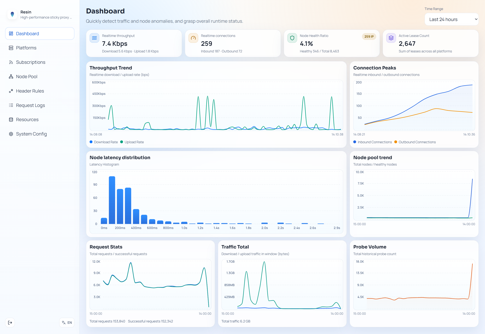

[English](README.md) | [简体中文](README.zh-CN.md) | [日本語](README.ja.md)

<div align="center">
  
  <h1>Resin</h1>
  <p><strong>大量のプロキシサブスクリプションを、安定・スマートで可観測性が高く、スティッキーセッションに対応した統一プロキシエントリポイントに変えます。</strong></p>
</div>

<p align="center">
  <a href="https://github.com/Resinat/Resin/releases"></a>
  <a href="https://github.com/Resinat/Resin/actions/workflows/release.yml"></a>
  <a href="https://github.com/Resinat/Resin/pkgs/container/resin"></a>
  <a href="https://github.com/Resinat/Resin/blob/master/LICENSE"></a>
  <a href="https://github.com/Resinat/Resin/blob/master/go.mod"></a>
  <a href="https://github.com/Resinat/Resin/releases"></a>
  <a href="DESIGN.md"></a>
</p>

---

**Resin** は、大量のプロキシノードを運用するために作られた**高性能なインテリジェントプロキシプールゲートウェイ**です。

分散したプロキシリソースを、**セッション保持（スティッキールーティング）** に対応した統一プロキシエントリポイントに集約し、不安定な下位のプロキシノードからサービスを守ります。

## 💡 Resin を選ぶ理由

- **大規模な管理**: ネイティブの高い並行処理性能で、10 万以上のプロキシノードを容易に扱えます。
- **スマートなスケジューリングとサーキットブレーカー**: 完全自動の**パッシブ + アクティブ**なヘルスチェック、出口 IP の調査、レイテンシ分析によって、不良ノードを的確に除外します。P2C とドメインを考慮したレイテンシ重み付けスコアリングで、最適なノードを選択します。
- **スマートなプロキシチェーン**: 出口ノードに適した中継ノードを自動で組み合わせるため、プロキシチェーンを個別に設定する必要はありません。
- **ビジネスに適したスティッキープロキシ**: 同じビジネスアカウントを安定した出口 IP に紐付け続けます。ノードに障害が発生した場合、Resin は同じ IP を持つ別のノードへシームレスに切り替えます。
- **複数のアクセス方式**: HTTP フォワードプロキシ、SOCKS5 フォワードプロキシ、URL ベースのリバースプロキシに対応し、さまざまなクライアントや連携方式に対応できます。
- **複数のインバウンドエンドポイント**: WebUI でホットリロード可能な待ち受けポートを追加し、ポートごとに管理コンソール、HTTP フォワード、HTTP リバース、SOCKS5 のアクセスを個別に制御できます。
- **可観測性**: 詳細なメトリクスとログに加え、視覚的な Web UI を備えています。プラットフォーム、アカウント、対象サイトなどで検索・監査できる、完全な構造化リクエストログも含まれます。
- **シンプルかつ強力**: デフォルト設定のまますぐに使える一方、エンタープライズレベルの要件に応える高度なカスタマイズも可能です。
- **サブスクリプションをまたいだ重複排除**: 異なるサブスクリプションに含まれる同一ノードを自動で統合し、ヘルス状態を共有します。
- **ホットリロード**: 一般的な設定は再起動なしで更新できます。既存のトラフィックを切断せずにサブスクリプションを更新できます。
- **状態の永続化**: ノードのヘルス状態、レイテンシ統計、リースの紐付けを再起動後も保持します。
- **既存環境に手を加えないスティッキーアクセス**: 既存のリクエストヘッダー（API キーなど）からアカウントの識別情報を抽出できるため、多くの場合クライアントのコード変更は不要です。
- **サブスクリプションの差分更新**: 現在の接続を中断せずに、サブスクリプションの更新を同期します。
- **柔軟なノードの分離**: Platform のルール（正規表現、地域など）を使って、ビジネスシナリオごとに独立したプロキシプールを構築できます。

> [!TIP]
> この README と [`DESIGN.md`](DESIGN.md) を AI に読み込ませれば、プロジェクトについて何でも質問できます。



---

## 🔌 対応プロトコルとサブスクリプション形式

### サブスクリプションのソース

- リモートのサブスクリプション URL: `http://` または `https://`。
- ローカルのサブスクリプション内容: UI/API にサブスクリプションの内容を直接貼り付けます。

### サブスクリプションの内容の形式

- sing-box JSON: `{"outbounds":[...]}` または outbound の生配列 `[...]`。
- Clash JSON/YAML: `{"proxies":[...]}` または YAML の `proxies:`。
- URI 行形式（1 行に 1 ノード）: `vmess://`、`vless://`、`trojan://`、`ss://`、`hysteria2://`、`http://`、`https://`、`socks5://`、`socks5h://`。
  `http://`、`https://`、`socks5://`、`socks5h://` では `scheme://[user:pass@]host:port` を使用します（`#tag` は任意。`https` では `sni`/`servername`/`peer` と `allowInsecure`/`insecure` のクエリパラメーターも使用できます）。
- プレーンな HTTP プロキシの行: `IP:PORT` または `IP:PORT:USER:PASS`（IPv4 と IPv6）。
- Base64 でエンコードされたテキストのサブスクリプション（URI 行やプレーンテキストのノード一覧用）。

### 対応するアウトバウンドノードの種類

- sing-box JSON や生の outbound の場合: `socks`、`http`、`shadowsocks`、`vmess`、`trojan`、`wireguard`、`hysteria`、`vless`、`shadowtls`、`tuic`、`hysteria2`、`anytls`、`ssh`。
- Clash から変換する場合: `ss`/`shadowsocks`、`socks`/`socks4`/`socks4a`/`socks5`、`http`、`vmess`、`vless`、`trojan`、`wireguard`/`wg`、`hysteria`、`hysteria2`/`hy2`、`tuic`、`anytls`、`ssh`。

## 🚀 クイックスタート

わずか 3 ステップで、プロキシサブスクリプションを高可用性のプロキシプールに変えられます。

### ステップ 1: デプロイと起動

クイックスタートには Docker Compose をおすすめします。

```yaml
# docker-compose.yml
services:
  resin:
    image: ghcr.io/resinat/resin:latest
    container_name: resin
    restart: unless-stopped
    environment:
      RESIN_ADMIN_TOKEN: "admin123" # Change to your admin dashboard password
      RESIN_PROXY_TOKEN: "my-token" # Change to your proxy password
      RESIN_LISTEN_ADDRESS: 0.0.0.0
      RESIN_PORT: 2260
    ports:
      - "2260:2260"
    volumes:
      - ./data/cache:/var/cache/resin
      - ./data/state:/var/lib/resin
      - ./data/log:/var/log/resin
```

`docker compose up -d` を実行してサービスを起動します。

カスタムエンドポイントのポートも、コンテナの外部から到達できる必要があります。Docker では実行中のコンテナに公開ポートを追加できないため、必要なポート範囲をあらかじめ `ports` で公開しておくか（例: `"2300-2399:2300-2399"`）、必要に応じてホストネットワークを使用してください。

*（Docker を使いたくない場合は、[その他のデプロイ方法](#other-deployment-options) へ進んでください。）*

### ステップ 2: プロキシノードのインポート

1. ブラウザで `http://127.0.0.1:2260` を開きます（必要に応じてサーバーの IP に置き換えてください）。
2. 設定した `RESIN_ADMIN_TOKEN` でログインします。
3. 左メニューの **Subscriptions** に移動し、ノードのサブスクリプションを追加します。
4. ノードプールが更新されるまで少し待ちます。

### ステップ 3: プロキシリクエストの送信を開始

クライアントのアクセス方式については、以下のセクションを参照してください。一般的なシナリオでは、クライアントの対応状況に応じて HTTP フォワードプロキシ、SOCKS5 フォワードプロキシ、リバースプロキシのいずれかを選べます。

## 🟢 基本的な使い方（非スティッキープロキシ）

### 標準的なプロキシとして接続する

ヘルス状態が自動管理される、高性能で大容量のプロキシプールが必要なだけなら、Resin はすぐに使えます。

Resin の起動後は、クライアントの対応状況に応じて HTTP フォワードプロキシ、SOCKS5 フォワードプロキシ、リバースプロキシのいずれかを選べます。
プロキシのパスワードが不要な場合は、明示的に `RESIN_PROXY_TOKEN=""` を設定してください（変数自体は定義されている必要があります）。この場合、HTTP フォワードプロキシは `http://127.0.0.1:2260`、SOCKS5 フォワードプロキシは `socks5://127.0.0.1:2260` で利用できます。
バイナリやソースから実行する場合、Resin は設定を読み込む前に、カレントディレクトリの `.env` ファイルも読み込みます。OS やシェルですでに設定されている環境変数は、`.env` の値より優先されます。

HTTP フォワードプロキシの例:

```bash
curl -x http://127.0.0.1:2260 \
  -U ":my-token" \
  https://api.ipify.org
```

SOCKS5 フォワードプロキシの例:

```bash
curl --proxy socks5h://127.0.0.1:2260 \
  -U "Default:my-token" \
  https://api.ipify.org
```

`RESIN_PROXY_TOKEN=""` の場合、SOCKS5 では認証なしのアクセスも許可されます。

クライアントが `BASE_URL` の上書きに対応している場合は、リバースプロキシモードも使用できます。
URL の形式: `/token/Platform(optional).Account(optional)/protocol/target`。
`https://api.ipify.org` へのリクエストの例:

```bash
curl http://127.0.0.1:2260/my-token/./https/api.ipify.org
```

> フォワードプロキシとリバースプロキシの選び方: 可能であれば、可観測性に優れたリバースプロキシをおすすめします。クライアントで BaseURL を変更できない場合や、フォワードプロキシの方が適したシナリオ（uTLS や WebAPI 以外のトラフィックなど）が必要な場合は、フォワードプロキシを使用してください。

### ノードの絞り込み

サービスで特定のノード（地域、サブスクリプションのソース、名前の正規表現など）が必要な場合は、Resin の Platform 機能を使用します。

`http://127.0.0.1:2260/ui/platforms` を開き、Platform を作成します。たとえば、米国と香港のノードだけを使う場合は、`MyPlatform` を作成し、地域フィルターを次のように設定します。

```
us
hk
```

ノードタグのルールは `<SubscriptionName>/<NodeTag>` にマッチし、1 行に 1 つの正規表現を書きます。通常のルールは OR で結合され、先頭の `*` は必須ルールを表し、先頭の `!` はいずれかにマッチしたノードを除外します。たとえば次の例では、期限切れや無効なノードを除外しつつ、香港または日本の専用ノードを選択します。

```text
Hong Kong
Japan
*Dedicated
!Expired
!Invalid
```

ルールの接頭辞として解釈されるのは先頭の 1 文字だけで、残りは Go の正規表現として扱われます。先頭の `!` を文字として扱いたい場合は `\!` とエスケープしてください。

フォワードプロキシ（HTTP / SOCKS5）では、認証情報に Platform を含めます。例:

```bash
curl -x http://127.0.0.1:2260 \
  -U "MyPlatform:my-token" \
  https://api.ipify.org
```

```bash
curl --proxy socks5h://127.0.0.1:2260 \
  -U "MyPlatform:my-token" \
  https://api.ipify.org
```

リバースプロキシでは、URL のプレフィックスに Platform を含めます。

```bash
curl http://127.0.0.1:2260/my-token/MyPlatform/https/api.ipify.org
```

## 📖 高度な使い方: スティッキーセッションプロキシ

ビジネスが IP の継続性や長時間のやり取りに依存している場合は、Resin の中核機能である **スティッキープロキシ** を使用します。

まず、2 つの中核となる概念を理解しましょう。

### 🎯 中核となる概念: Platform と Account

- **Platform**: 分離されたノードプールです。フィルター（米国のノードのみなど）を使って構築できます。Resin には、利用可能なすべてのノードを含むデフォルトの `Default` プラットフォームが用意されています。
- **Account**: 一意のビジネス上の識別子です（`Tom` や `user_1` など）。Account を含むリクエストについて、Resin はトラフィックを専用の高品質な出口ノードに固定します。そのノードに障害が発生した場合、Resin はシームレスに再試行し、同じ IP を持つ別のノードに切り替えます。

### スティッキープロキシのアクセス形式

#### 方法 1: フォワードプロキシ（HTTP Proxy / SOCKS5）

HTTP フォワードプロキシと SOCKS5 フォワードプロキシは、同じ識別情報の形式 `Platform.Account:RESIN_PROXY_TOKEN` を共有します。

識別情報をプロキシ認証に入れるだけです。

```bash
# HTTP forward proxy: bind business account user_tom to a stable dedicated outbound IP
curl -x http://127.0.0.1:2260 \
  -U "Default.user_tom:my-token" \
  https://api.ipify.org
```

```bash
# SOCKS5 forward proxy: uses the same identity format as HTTP forward proxy
curl --proxy socks5h://127.0.0.1:2260 \
  -U "Default.user_tom:my-token" \
  https://api.ipify.org
```

#### 方法 2: リバースプロキシ（URL の Account、手早い利用や手動デバッグ向け）

サービスの BaseURL を Resin のリバースプロキシ URL に置き換えることで、トラフィックが直接 Resin を経由するようになります。
高度な URL の形式: `http://host:2260/token/platform.account/protocol/target`:

```bash
# Example: user_tom accesses api.ipify.org over https
curl "http://127.0.0.1:2260/my-token/Default.user_tom/https/api.ipify.org"
```

> URL の Account セグメントは、手早い利用や手動デバッグのために設計されています。
> 長期運用する本番環境の連携では、ヘッダー（`X-Resin-Account`）で Account を渡すことをおすすめします。

#### 方法 3: リバースプロキシ + `X-Resin-Account` ヘッダー（本番環境の連携に推奨）

クライアントや SDK がカスタムリクエストヘッダーに対応している場合は、`X-Resin-Account` で Account を明示的に渡します。
これが推奨される、最も安定した方法です。

Account の取得元の優先順位: `X-Resin-Account` ヘッダー > リバースプロキシ URL 内の Account > ヘッダー抽出ルール。

例:

```bash
curl "http://127.0.0.1:2260/my-token/MyPlatform/https/api.example.com/v1/orders" \
  -H "X-Resin-Account: user_tom"
```

#### 方法 4: リバースプロキシ + ヘッダールール（既存環境にほぼ手を加えない連携）

クライアントで `X-Resin-Account` を設定できない場合でも、Resin はヘッダールールによって既存のビジネス用ヘッダー（API Key、Token、Cookie など）から Account を抽出できます。

リクエストにすでに `Authorization` ヘッダーが含まれているとします。

1. Platform Configuration で、`Reverse-proxy empty-account behavior` を `Extract specified request headers as Account` に設定します。
2. `Headers used to extract Account` を `Authorization` に設定します。

すると、URL で Account を省略しても、Resin はヘッダーから Account を解析できます。

```bash
curl "http://127.0.0.1:2260/my-token/MyPlatform/https/api.example.com/v1/orders" \
  -H "Authorization: sk-abc123"
```

この例では、Resin は `sk-abc123` を Account として使用します。以降、同じキーを持つリクエストは、ルーティングの条件が許す限り、同じ出口 IP に紐付けられたままになります。

> [!TIP]
> Platform のヘッダー設定に加えて、Resin は URL のプレフィックスごとに抽出に使うヘッダーを選ぶ高度なルールにも対応しています。この README と [DESIGN.md](DESIGN.md) を使って、両方のモードの説明を AI に尋ねることができます。

> ヘッダーによる Account の抽出は、正当な法的根拠（ユーザーの許可や契約上の許諾など）がある場合にのみ有効にしてください。また、ログの記録、保存、アクセス制御のポリシーが、適用される法律と対象サービスの規約に準拠していることを確認してください。

---

## 🤖 サードパーティのプロジェクトとの連携

Resin との連携方法はクライアントによって異なり、コードへの影響の大きさも異なります。

💡 **スティッキープロキシが不要な場合**

| アクセス方式 | コードへの影響 | 備考 |
| :--- | :--- | :--- |
| フォワードプロキシ | 🟢 **変更不要** | HTTP または SOCKS5 のプロキシアドレスと認証情報を設定するだけです。 |
| リバースプロキシ | 🟢 **変更不要〜軽微** | 通常はサービスの BaseURL を変更するだけで済みます。 |

💡 **スティッキープロキシが必要な場合**

| アクセス方式 | コードへの影響 | 備考 |
| :--- | :--- | :--- |
| フォワードプロキシ | 🟡 **中程度の変更** | ユーザーごとのリクエストで異なる認証情報が必要です。HTTP と SOCKS5 はどちらも `platform.account:token` を使用します。 |
| リバースプロキシ | 🟡 **中程度の変更** | `X-Resin-Account` リクエストヘッダーを追加するか、アカウント情報を使ってリバースプロキシの URL パスを動的に組み立てます。 |
| リバースプロキシ + ヘッダールール | 🟢 **変更不要〜軽微** | Resin が元のヘッダー（`Authorization` など）から Account を抽出し、IP を自動で紐付けます。 |

👉 **すばやく連携するためのスクリプト/プロンプト:**
開発者の方で、既存のプロジェクトを Resin のスティッキー連携にネイティブ対応させる修正を AI に手伝ってもらいたい場合は、次を使用してください。

- [doc/integration-prompt.md](doc/integration-prompt.md)

---

<a id="other-deployment-options"></a>
## その他のデプロイ方法

<details>
<summary><b>方法 1: ビルド済みバイナリを実行する</b></summary>
<br>
プロジェクトの <a href="https://github.com/Resinat/Resin/releases">Release</a> ページにアクセスし、お使いの OS/アーキテクチャ向けのパッケージをダウンロードします。展開後、単一のバイナリ <code>resin</code> を実行します。

```bash
RESIN_ADMIN_TOKEN=<admin-dashboard-password> \
RESIN_PROXY_TOKEN=<proxy-password> \
RESIN_STATE_DIR=./data/state \
RESIN_CACHE_DIR=./data/cache \
RESIN_LOG_DIR=./data/log \
RESIN_LISTEN_ADDRESS=0.0.0.0 \
RESIN_PORT=2260 \
./resin
```

または、作業ディレクトリに `.env` ファイルを作成して `./resin` を実行します。

```dotenv
RESIN_ADMIN_TOKEN=<admin-dashboard-password>
RESIN_PROXY_TOKEN=<proxy-password>
RESIN_STATE_DIR=./data/state
RESIN_CACHE_DIR=./data/cache
RESIN_LOG_DIR=./data/log
RESIN_LISTEN_ADDRESS=0.0.0.0
RESIN_PORT=2260
```
</details>

<details>
<summary><b>方法 2: ソースからビルドする</b></summary>
<br>
前提条件: Go 1.26.10 と Node.js がインストールされていること。

```bash
# 1. Clone Resin source
git clone https://github.com/Resinat/Resin.git

# 2. Build WebUI
cd Resin/webui
npm install && npm run build
cd ..

# 3. Build Resin core
go build -tags "with_quic with_wireguard with_grpc with_utls" -o resin ./cmd/resin

# 4. Run
RESIN_ADMIN_TOKEN=<admin-dashboard-password> \
RESIN_PROXY_TOKEN=<proxy-password> \
RESIN_STATE_DIR=./data/state \
RESIN_CACHE_DIR=./data/cache \
RESIN_LOG_DIR=./data/log \
RESIN_LISTEN_ADDRESS=127.0.0.1 \
RESIN_PORT=2260 \
./resin
```
</details>

---

## 🛠️ よくある質問

- **Q: LAN や localhost 宛ての通信でプロキシノードを経由しないようにするには？**
  - **A**: `RESIN_PROXY_BYPASS` に、セミコロン/カンマ/改行で区切ったルールのリストを設定します。マッチしたリクエストは、プロキシノードを経由せず Resin から直接接続されます。例: `RESIN_PROXY_BYPASS="localhost;127.*;10.*;172.16.0.0/12;192.168.*;<local>"`。対応するルールには、ホストの完全一致、`*`/`?` のワイルドカード、CIDR 範囲、ドットを含まないホスト名を表す `<local>` があります。
- **Q: `RESIN_PROXY_TOKEN` が未定義で起動に失敗する場合は？**
  - **A**: プロキシのパスワードが不要な場合でも、明示的に空に設定する必要があります: `RESIN_PROXY_TOKEN=""`。空の環境変数を削除してしまうシェルでは、`RESIN_PROXY_TOKEN=` を記述した `.env` ファイルを作成してください。
- **Q: Resin が `RESIN_AUTH_VERSION=LEGACY_V0` を拒否するのはなぜですか？**
  - **A**: `LEGACY_V0` はサポートされなくなりました。`RESIN_AUTH_VERSION` を削除するか、`V1` に設定してください。レガシー認証を使用していたリリースからアップグレードする場合は、[v1.0.0 認証移行ガイド](doc/v1.0.0-migration-guide.md) を参照してください。
- **Q: SOCKS5 クライアントが接続できないのはなぜですか？**
  - **A**: `RESIN_PROXY_TOKEN` が空でない場合、クライアントは SOCKS5 のユーザー名/パスワード認証を送信する必要があります。明示的に空文字列が設定されている場合は、`NO AUTH` も許可されます。
- **Q: WebSocket（ws/wss）のリバースプロキシのパスはどう書けばよいですか？**
  - **A**: URL パスのプロトコル欄には、引き続き `http` または `https` を指定する必要があります（`ws`/`wss` ではありません）。Resin が WebSocket のアップグレードを自動で検出して処理します。
---

## 🔗 フレンズ

- [Linux.do](https://linux.do/)

---

## ⚠️ ライセンスと免責事項

- **ライセンス**: このプロジェクトは [MIT License](LICENSE) のもとでライセンスされています。
- **利用範囲**: このプロジェクトは、プロキシのスケジューリングと管理に関する技術研究およびエンジニアリング実践のために提供されています。法律、コンプライアンス、監査、セキュリティに関する助言を構成するものではありません。
- **合法的な利用の要件**: 利用にあたっては、適用される法律、規制、対象サービスの利用規約（ToS）、データ処理に関する義務を遵守していること、ならびにプロキシノード、対象リソース、関連データについて適切な権限を有していることを、利用者自身の責任で確認してください。
- **禁止される利用**: このプロジェクトを、不正アクセス、制御の回避、詐欺、攻撃、不正なトラフィックの生成、その他の違法または規約に反する活動に使用してはなりません。
- **無保証**: このプロジェクトは「現状のまま」提供され、商品性、特定目的への適合性、権利非侵害を含むがこれらに限定されない、明示または黙示のいかなる保証もありません。
- **責任の制限**: 適用される法律で認められる最大限の範囲において、作者およびコントリビューターは、このプロジェクトの使用または使用不能から生じる直接的、間接的、付随的、特別、懲戒的、または結果的な損害について、一切の責任を負いません。
